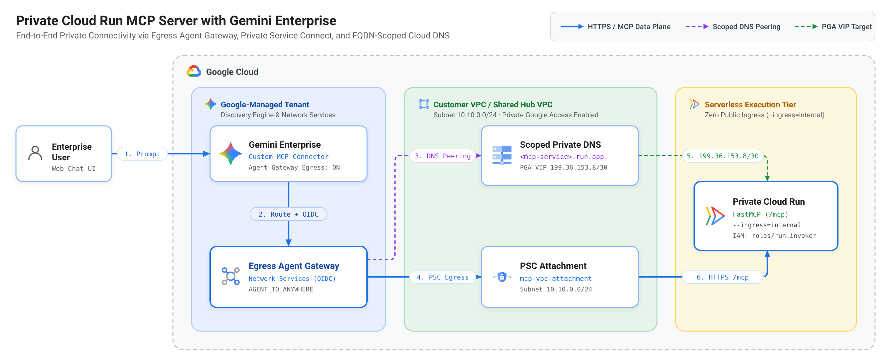

# Securely Connect Gemini Enterprise to Private Cloud Run MCP Servers

End-to-end reference implementation, automation scripts, and step-by-step setup guide (CLI + Cloud Console UI) for connecting **Gemini Enterprise** privately to internal **Model Context Protocol (MCP)** servers running on **Google Cloud Run** (`--ingress=internal`, `--no-allow-unauthenticated`).

This repository includes full configurations and executable scripts for **both** private Google Cloud routing patterns:
- **Option A — Subnet Private Google Access (PGA, `199.36.153.8/30`):** Zero extra networking endpoints for standard VPCs with Private Google Access enabled.
- **Option B — Global Private Service Connect (PSC) Endpoint for Google APIs (`all-apis`, `240.0.0.10`):** Dedicated `/32` internal VPC route for isolated enterprise VPCs that delete or override the `0.0.0.0/0` default internet route.

---

## 1. Architecture Overview



### End-to-End Request & DNS Flow (Two Private Bridges)

Because Cloud Run is serverless (`*.run.app`), connecting Gemini Enterprise privately to a Cloud Run MCP server involves **two private network hops** and **one scoped DNS lookup**:

```text
[1. Gemini Enterprise]
       │  Sends URL: POST https://<MCP_SERVICE_FQDN>/mcp
       ▼
[2. Egress Agent Gateway] ──(DNS Peering)──► Queries mcp-vpc Private Cloud DNS:
       │                                      "What IP is <MCP_SERVICE_FQDN>?"
       │                                      ◄── Returns: 199.36.153.8 (PGA) or 240.0.0.10 (PSC)
       │  Opens HTTPS connection to that VIP:443
       │  (keeping TLS SNI & HTTP Host = <MCP_SERVICE_FQDN>)
       ▼
[3. Bridge 1: PSC Network Attachment (mcp-vpc-attachment)]
       │  Brings packet from Google's tenant project INTO your VPC subnet (Source IP = 10.10.0.x)
       ▼
[4. Bridge 2: Subnet PGA (199.36.153.8/30) OR PSC 'all-apis' Endpoint (240.0.0.10)]
       │  Carries packet privately FROM your VPC subnet to Google's serverless Cloud Run frontend,
       │  stamped with your source VPC identity (mcp-vpc)
       ▼
[5. Cloud Run Serverless Frontend (--ingress=internal)]
          1. Reads Host/SNI header (<MCP_SERVICE_FQDN>) -> locates your Cloud Run service
          2. Verifies source VPC (mcp-vpc) -> satisfies --ingress=internal
          3. Validates IAM (X-Serverless-Authorization) + OAuth (Authorization) -> HTTP 200!
```

### Key Design Pillars

1. **Private Network Path (No Public Exposure):**
   - Your Cloud Run MCP server runs with **Internal Ingress (`--ingress=internal`)** and **IAM Authentication (`--no-allow-unauthenticated`)**. Direct calls from the public internet are rejected at Google's edge (`HTTP 404` / `HTTP 403`).
2. **FQDN-Scoped Private Cloud DNS (Safe for Shared / Hub VPCs):**
   - Instead of overriding `*.run.app.` across an entire VPC, both the Private Cloud DNS zone and Agent Gateway DNS peering are scoped **exclusively** to your MCP service's exact FQDN (`<MCP_SERVICE_FQDN>.`).
   - Because Cloud DNS uses longest-suffix matching, every other Cloud Run service in a Shared or Hub VPC continues resolving normally.
3. **Dual-Header Zero-Trust Identity:**
   - **Infrastructure Layer (`X-Serverless-Authorization`):** Gemini Enterprise attaches a Google-signed OIDC token for its requesting service account, validated automatically by Cloud Run IAM (`roles/run.invoker`) before your container is reached.
   - **Application Layer (`Authorization: Bearer <access_token>`):** Gemini Enterprise forwards the signed-in user's OAuth 2.0 access token, validated by [`OAuth2ValidationMiddleware`](server.py) in `server.py` so every tool call executes with per-user identity.

---

## 2. Repository Structure

```text
ge-secure-cloud-run-mcp/
├── .env.example                          # Template environment variables (PGA & PSC options)
├── .env                                  # Local project config (gitignored — never committed)
├── .gitignore                            # Protects .env, .venv, and credentials
├── Dockerfile                            # Python 3.12 container image for Cloud Run
├── pyproject.toml                        # Python project metadata
├── requirements.txt                      # Python dependencies
├── server.py                             # StreamableHTTP MCP server + OAuth 2.0 middleware
├── docs/
│   ├── architecture.png                  # High-resolution GCP architecture diagram
│   └── architecture.svg                  # Vector GCP architecture diagram
└── scripts/
    ├── 01_enable_apis_and_deploy_mcp.sh  # Enables APIs, deploys Cloud Run, grants run.invoker
    ├── 02_setup_vpc.sh                   # Creates VPC, subnet (with PGA) & PSC Network Attachment
    ├── 03_setup_agent_gateway.sh         # Creates Agent Gateway, grants SA IAM & attaches VPC
    ├── 04a_setup_routing_pga.sh          # Option A: Scoped DNS + PGA (199.36.153.8/30)
    ├── 04b_setup_routing_psc.sh          # Option B: Scoped DNS + PSC Endpoint (240.0.0.10)
    ├── 05_enable_connector_egress.sh     # Patches DataConnector use_agent_gateway_egress=true
    ├── 06_verify_logs.sh                 # Verifies Gateway & Cloud Run logs in Cloud Logging
    └── test_local_mcp.py                 # Local smoke test for /health and MCP tool calls
```

---

## 3. Local Quickstart & Smoke Test

Verify the MCP server locally before deploying to Google Cloud:

```bash
cd ge-secure-cloud-run-mcp

# 1. Create and activate the virtual environment
python3 -m venv .venv
source .venv/bin/activate
pip install -r requirements.txt

# 2. Terminal 1: Run the MCP server locally (disable OAuth check for quick local test)
REQUIRE_OAUTH=false python server.py

# 3. Terminal 2: Run the local MCP smoke test (tests /health, initialize, tools/list, tools/call)
source .venv/bin/activate
python scripts/test_local_mcp.py
```

To test OAuth 2.0 validation locally with a real Google access token:

```bash
# Terminal 1: Start with REQUIRE_OAUTH=true
REQUIRE_OAUTH=true python server.py

# Terminal 2: Pass a real OAuth token
TEST_BEARER_TOKEN="$(gcloud auth print-access-token)" python scripts/test_local_mcp.py
```

---

## 4. Prerequisites & IAM Matrix

### 4.1 Region Pairing Rule

Your Egress Agent Gateway, VPC subnet, PSC network attachment, and Cloud Run MCP service should reside in the region paired with your Gemini Enterprise app location:

| Gemini Enterprise App Location (`GE_LOCATION`) | Required Gateway & VPC Subnet Region (`REGION`) |
| :--- | :--- |
| `global` or `us` | `us-central1` |
| `eu` | `europe-west1` |

### 4.2 Required APIs

Enabled automatically by `scripts/01_enable_apis_and_deploy_mcp.sh`:
- `run.googleapis.com`, `cloudbuild.googleapis.com`, `artifactregistry.googleapis.com`
- `discoveryengine.googleapis.com`
- `compute.googleapis.com`, `dns.googleapis.com`
- `networkservices.googleapis.com`, `networksecurity.googleapis.com`
- `agentregistry.googleapis.com`, `cloudapiregistry.googleapis.com`

### 4.3 Required User / Administrator IAM Roles (For Your Account)

If your Google account is **Project `Owner` (`roles/owner`)**, you already have all project-level permissions below. Otherwise, ensure your user account has:

| Scope | Required IAM Role(s) | Purpose |
| :--- | :--- | :--- |
| **Target Project (`PROJECT_ID`)** | `roles/serviceusage.serviceUsageAdmin`<br>`roles/resourcemanager.projectIamAdmin`<br>`roles/run.admin`<br>`roles/iam.serviceAccountUser`<br>`roles/cloudbuild.builds.editor`<br>`roles/discoveryengine.editor`<br>`roles/networkservices.admin`<br>`roles/networksecurity.admin` | Enables APIs, grants service account IAM bindings, deploys the Cloud Run service, configures Gemini Enterprise, and creates the Egress Agent Gateway & AuthzPolicy. |
| **VPC Host Project (`VPC_HOST_PROJECT_ID`)**<br>*(same as `PROJECT_ID` if Standalone VPC)* | `roles/compute.networkAdmin`<br>`roles/dns.admin`<br>`roles/resourcemanager.projectIamAdmin` | Creates the VPC, subnet, PSC Network Attachment (and optional PSC `all-apis` endpoint), Private Cloud DNS zone, and gateway networking IAM bindings. |
| **Organization / Project Policy** *(if enforced)* | `roles/orgpolicy.policyAdmin` | Overrides `Disable custom MCP server connector for Gemini Enterprise` on `PROJECT_ID`. |

### 4.4 Google-Managed Service Account IAM Summary (Granted by Scripts)

| Service Account | Required IAM Role(s) | Target Resource / Project | Purpose |
| :--- | :--- | :--- | :--- |
| **Default Compute SA** *(for Cloud Build)*<br>`PROJECT_NUMBER-compute@developer.gserviceaccount.com` | `roles/cloudbuild.builds.builder`<br>`roles/storage.objectViewer`<br>`roles/logging.logWriter`<br>`roles/artifactregistry.writer` | `PROJECT_ID` | Builds and pushes the container image during `gcloud run deploy --source=.`. |
| **Requesting Gemini Enterprise SA**<br>`service-PROJECT_NUMBER@gcp-sa-discoveryengine.iam.gserviceaccount.com` | `roles/run.invoker` | Cloud Run service (`SERVICE_NAME`) | Authenticates `X-Serverless-Authorization` OIDC tokens on your private Cloud Run MCP service. |
| **Agent Gateway Networking SA**<br>`service-PROJECT_NUMBER@gcp-sa-agentgateway.iam.gserviceaccount.com` | `roles/agentregistry.viewer`<br>`roles/compute.networkUser`<br>`roles/dns.peer` | `agentregistry.viewer` on `PROJECT_ID`;<br>`networkUser` & `dns.peer` on `VPC_HOST_PROJECT_ID` | Auto-created by GCP when the first Agent Gateway is provisioned; attaches to the PSC Network Attachment and peers DNS. |
| **Data Egress Proxy SA**<br>`service-PROJECT_NUMBER@gcp-sa-dep.iam.gserviceaccount.com` | `roles/compute.networkUser`<br>`roles/dns.peer` | `VPC_HOST_PROJECT_ID` *(equals `PROJECT_ID` if standalone)* | Sends egress proxy packets into your VPC subnet and resolves Private Cloud DNS. |

---

## 5. End-to-End GCP Setup from Scratch (New Project)

### Step 0: Configure `.env` & Check Organization Policy

1. Copy `.env.example` to `.env` and fill in `PROJECT_ID`, `PROJECT_NUMBER`, and `VPC_HOST_PROJECT_ID` (set equal to `PROJECT_ID` for a standalone VPC):
   ```bash
   cp .env.example .env
   # Look up your Project Number if needed:
   gcloud projects describe YOUR_PROJECT_ID --format="value(projectNumber)"
   ```
2. **Check Organization Policy for Custom MCP Connectors:**
   In many Google Cloud organizations, Custom MCP connectors are disabled by default:
   - Open **IAM & Admin -> Organization Policies** in `PROJECT_ID`.
   - Filter for **`Disable custom MCP server connector for Gemini Enterprise`**.
   - If enforced, click **Manage policy -> Override parent's policy**, set enforcement to **Off (Not enforced)**, and click **Set policy**.

---

### Step 1: Create Your Gemini Enterprise App

1. In the Google Cloud Console (`PROJECT_ID`), open **Gemini Enterprise -> Apps -> Create app**.
2. Choose location **`global`** (or **`us`**, which pairs with `REGION=us-central1`; or **`eu`**, which pairs with `REGION=europe-west1`).
3. Create the app to initialize Discovery Engine in your project.

---

### Step 2: Enable APIs, Deploy Cloud Run MCP Server & Grant Invoker IAM

Run [`scripts/01_enable_apis_and_deploy_mcp.sh`](scripts/01_enable_apis_and_deploy_mcp.sh):

```bash
./scripts/01_enable_apis_and_deploy_mcp.sh
```

What this script does:
- **`[1/4]`** Enables all 10 required Google Cloud APIs in `PROJECT_ID`.
- **`[2/4]`** Grants Cloud Build permissions (`cloudbuild.builds.builder`, `storage.objectViewer`, `logging.logWriter`, `artifactregistry.writer`) to `PROJECT_NUMBER-compute@developer.gserviceaccount.com`.
- **`[3/4]`** Builds and deploys [`server.py`](server.py) to Cloud Run (`private-vpc-mcp`) with `--ingress=internal` and `--no-allow-unauthenticated` (with automatic IAM propagation retry on brand-new projects), and writes `MCP_SERVICE_FQDN` into `.env`.
- **`[4/4]`** Provisions `service-PROJECT_NUMBER@gcp-sa-discoveryengine.iam.gserviceaccount.com` and grants it `roles/run.invoker` on the Cloud Run service.

<details>
<summary><b>Or inspect / configure via Google Cloud Console UI</b></summary>

- **Cloud Run Service & Ingress:** Go to **Cloud Run -> `private-vpc-mcp`**:
  - Under **Networking -> Ingress control**, verify **Internal** (`Allow internal traffic only`) is selected.
  - Under **Security -> Authentication**, verify **Require authentication** (`--no-allow-unauthenticated`) is selected.
  - Under the **Permissions** tab -> **Grant access**, verify `service-PROJECT_NUMBER@gcp-sa-discoveryengine.iam.gserviceaccount.com` has role **Cloud Run Invoker** (`roles/run.invoker`).
</details>

---

### Step 3: Create VPC, Subnet & PSC Network Attachment

Run [`scripts/02_setup_vpc.sh`](scripts/02_setup_vpc.sh):

```bash
./scripts/02_setup_vpc.sh
```

What this script does *(no manual VPC or firewall rule creation needed)*:
- **`[1/3]`** Creates the custom-mode VPC (`mcp-vpc`) in `VPC_HOST_PROJECT_ID`.
- **`[2/3]`** Creates the regional subnet (`mcp-subnet`, `10.10.0.0/24` in `us-central1`) with **Private Google Access** enabled.
- **`[3/3]`** Creates the **PSC Network Attachment** (`mcp-vpc-attachment`) pointing to `mcp-subnet` with `ACCEPT_AUTOMATIC`.

<details>
<summary><b>Or configure via Google Cloud Console UI</b></summary>

1. **Create VPC & Subnet:** Go to **VPC network -> VPC networks -> Create VPC network**:
   - **Name:** `mcp-vpc`
   - **Subnet creation mode:** `Custom` -> click **Add subnet**:
     - **Name:** `mcp-subnet` | **Region:** `us-central1` | **IPv4 range:** `10.10.0.0/24`
     - **Private Google Access:** **On**
   - Click **Create**.
2. **Create PSC Network Attachment:** Go to **Network Services -> Private Service Connect -> Network attachments -> Create network attachment**:
   - **Name:** `mcp-vpc-attachment` | **Network:** `mcp-vpc` | **Region:** `us-central1` | **Subnetwork:** `mcp-subnet`
   - **Connection preference:** `Acceptall connections automatically` -> click **Create**.
</details>

---

### Step 4: Create Egress Agent Gateway, Grant Gateway IAM & Attach VPC

Run [`scripts/03_setup_agent_gateway.sh`](scripts/03_setup_agent_gateway.sh):

```bash
./scripts/03_setup_agent_gateway.sh
```

What this script does automatically:
- **`[1/3]`** Creates the Google-managed **Egress Agent Gateway** (`mcp-private-gateway`, `AGENT_TO_ANYWHERE`, protocol `MCP`) and waits for provisioning *(which triggers Google Cloud to auto-create `service-PROJECT_NUMBER@gcp-sa-agentgateway.iam.gserviceaccount.com` in brand-new projects)*.
- **`[2/3]`** Grants `roles/agentregistry.viewer`, `roles/compute.networkUser`, and `roles/dns.peer` to `@gcp-sa-agentgateway` (and `@gcp-sa-dep`).
- **`[3/3]`** Attaches `mcp-vpc-attachment` (`networkConfig.egress.networkAttachment`) to `mcp-private-gateway` via the `v1alpha1` API and verifies the PSC connection status.

> **Why Use the Script for Step 4:**  
> While you can create the bare Agent Gateway in the Cloud Console UI (**Network Services -> Agent Gateways -> Add Gateway**), attaching `networkConfig.egress.networkAttachment` is **not exposed in the Create UI form** (and in brand-new projects, `@gcp-sa-agentgateway` is only generated during the first gateway creation call). Running `03_setup_agent_gateway.sh` handles creation, IAM, and PSC Network Attachment binding in one automated step.

---

### Step 5: Configure Private DNS & Routing (Choose Option A OR Option B)

Choose **one** of the two routing scripts below depending on your VPC architecture (both scope Private Cloud DNS strictly to `${MCP_SERVICE_FQDN}.` so no other `*.run.app` services are affected):

| Criteria | Option A: Subnet Private Google Access (`PGA`) | Option B: Global PSC Endpoint (`all-apis`) |
| :--- | :--- | :--- |
| **Script** | [`./scripts/04a_setup_routing_pga.sh`](scripts/04a_setup_routing_pga.sh) | [`./scripts/04b_setup_routing_psc.sh`](scripts/04b_setup_routing_psc.sh) |
| **Target VIPs** | `199.36.153.8/30` (`199.36.153.8` – `.11`) | `240.0.0.10` (custom internal `/32` IP in VPC) |
| **Extra VPC Resources** | None (built-in subnet flag) | 1 Global Internal Address + 1 Global Forwarding Rule (`pscgoogleapis`) |
| **VPC Route Used** | Standard `0.0.0.0/0 -> default-internet-gateway` | Dedicated internal `240.0.0.10/32 -> pscgoogleapis` |
| **When to Choose** | Standard VPCs with default internet route intact *(Recommended Default)* | Restricted / isolated VPCs where `0.0.0.0/0` is deleted or overridden |

#### Option A: Subnet Private Google Access (`199.36.153.8/30` — Recommended Default)

```bash
./scripts/04a_setup_routing_pga.sh
```

What each step in `04a_setup_routing_pga.sh` does and why:
- **`[1/4]` Ensures Subnet PGA is enabled (`mcp-subnet`):** Allows private-only packets from `mcp-subnet` (`10.10.0.x`) to reach Google's private `199.36.153.8/30` VIPs.
- **`[2/4]` Creates Gateway Outbound `REQUEST_AUTHZ` policy:** Permits outbound MCP HTTP requests (`POST /mcp`) through `mcp-private-gateway`.
- **`[3/4]` Creates Scoped Private Cloud DNS zone (`<MCP_SERVICE_FQDN>.` -> `199.36.153.8/30`):** Overrides DNS **only** for your single MCP Cloud Run hostname so traffic stays on Google's private backbone instead of timing out against public internet IPs (`216.239.36.53`).
- **`[4/4]` Configures Gateway DNS Peering & confirms `--ingress=internal`:** Peers `<MCP_SERVICE_FQDN>.` on `mcp-private-gateway` *(API-only `v1alpha1` field)* so the gateway resolves your Private Cloud DNS zone.

#### Option B: Global PSC Endpoint for Google APIs (`all-apis` / `240.0.0.10`)

```bash
./scripts/04b_setup_routing_psc.sh
```

What each step in `04b_setup_routing_psc.sh` does and why:
- **`[1/6]` Ensures Subnet PGA is enabled (`mcp-subnet`):** Required by GCP even when sending traffic to a PSC Google APIs endpoint.
- **`[2/6]` Reserves Global Internal IP (`240.0.0.10`, `ip-psc-googleapis`):** Allocates a dedicated private `/32` IP inside `mcp-vpc` with purpose `PRIVATE_SERVICE_CONNECT`.
- **`[3/6]` Creates Global PSC Forwarding Rule (`pscgoogleapis` -> `all-apis`):** Binds `240.0.0.10` to Google's built-in global `all-apis` bundle (which includes `*.run.app`—no Load Balancer or Service Attachment needed on Cloud Run!) and automatically injects a dedicated `240.0.0.10/32 -> pscgoogleapis` internal route into `mcp-vpc`.
- **`[4/6]` Ensures Gateway Outbound `REQUEST_AUTHZ` policy exists.**
- **`[5/6]` Updates Scoped Private Cloud DNS (`<MCP_SERVICE_FQDN>.` -> `240.0.0.10`):** Points only your single MCP Cloud Run hostname to `240.0.0.10`.
- **`[6/6]` Configures Gateway DNS Peering & confirms `--ingress=internal`.**

<details>
<summary><b>How to test Option B in a zero-default-route VPC (or configure DNS / PSC via Console UI)</b></summary>

- **Testing Option B without a default internet route:**
  1. In **VPC network -> Routes**, select `mcp-vpc` and delete the **`0.0.0.0/0`** (`Default internet gateway`) route.
  2. Notice that Option A (`199.36.153.8/30`) now fails because PGA depends on the `0.0.0.0/0` route next-hop.
  3. Run `./scripts/04b_setup_routing_psc.sh`, wait ~60s for DNS TTL expiry, and test again—requests succeed over `240.0.0.10:443` via the automatic `240.0.0.10/32 -> pscgoogleapis` route!
- **Cloud Console UI equivalents for DNS & PSC Endpoint:**
  - **Private Cloud DNS Zone:** **Network Services -> Cloud DNS -> Create zone** -> Zone type: `Private`, Zone name: `priv-zone-mcp-fqdn`, DNS name: `<MCP_SERVICE_FQDN>.`, Networks: `mcp-vpc` -> Add Standard `A` record (`TTL 60`) pointing to `199.36.153.8`–`.11` (Option A) or `240.0.0.10` (Option B).
  - **PSC Endpoint for Google APIs (Option B):** **Network Services -> Private Service Connect -> Connected endpoints -> Connect endpoint** -> Target: `All Google APIs`, Endpoint name: `pscgoogleapis`, Network: `mcp-vpc`, IP address: `240.0.0.10` (`ip-psc-googleapis`).
  - *(Note: `networkConfig.dnsPeeringConfig` and `authzPolicies` in `[4/4]` / `[6/6]` are currently API-only (`v1alpha1`) and are configured automatically by `04a` / `04b`.)*
</details>

---

### Step 6: Bind the Egress Agent Gateway to Your Gemini Enterprise App

1. In the Cloud Console, open **Gemini Enterprise** and select your app.
2. Navigate to **Security -> Configuration**.
3. Under **Agent Gateway configuration**, enter the gateway resource name using your **Project Number**:
   ```text
   projects/PROJECT_NUMBER/locations/REGION/agentGateways/mcp-private-gateway
   ```
   *(Example: `projects/123456789012/locations/us-central1/agentGateways/mcp-private-gateway`)*
4. Click **Save**.

---

### Step 7: Create OAuth 2.0 Client, Add Custom MCP Server & Enable Gateway Egress

#### 7A. Create OAuth 2.0 Web Client Credentials

1. In the Cloud Console (`PROJECT_ID`), go to **APIs & Services -> OAuth consent screen** and configure it as **Internal**.
2. Go to **APIs & Services -> Credentials -> Create credentials -> OAuth client ID**:
   - **Application type:** `Web application`
   - **Name:** `ge-mcp-oauth-client`
   - **Authorized redirect URIs:**
     ```text
     https://vertexaisearch.cloud.google.com/oauth-redirect
     ```
3. Copy the **Client ID** and **Client Secret**.

#### 7B. Register the Custom MCP Server Data Store in Gemini Enterprise

1. Open your Gemini Enterprise app -> **Connected data stores -> + New** (or **Create data store**).
2. Search for **Custom MCP Server** and click **Add MCP server**.
3. Fill in:

| Console UI Field | Value |
| :--- | :--- |
| **Base URL** *(MCP Server URL)* | `https://<MCP_SERVICE_FQDN>/mcp`<br>*(Important: Even though the UI labels this field **Base URL**, you **must** include `/mcp` at the end! This field is read-only after creation.)* |
| **Authentication** | `OAuth 2.0` |
| **Authorization URL** | `https://accounts.google.com/o/oauth2/v2/auth` |
| **Authorization URL Parameters** | `&access_type=offline&prompt=consent` |
| **Token URL** | `https://oauth2.googleapis.com/token` |
| **Client ID** | `<Client ID from Step 7A>` |
| **Client Secret** | `<Client Secret from Step 7A>` |
| **Scopes** | `openid email profile` |

4. Click **Verify Auth**, complete the browser OAuth flow, enter a display name (for example, `custom-mcp-private`), and click **Save**.
   *(Note: Any `HTTP 404` tool-discovery warning during **Save** is expected because the Console UI creates the connector with `"use_agent_gateway_egress": false`—proceed to **Step 7C**!)*

#### 7C. Enable `use_agent_gateway_egress: true` and `ACTIONS` Mode (Required — API Only)

Because the Google Cloud Console UI does not yet expose a toggle for `use_agent_gateway_egress` on Custom MCP connectors, you **must** run [`scripts/05_enable_connector_egress.sh`](scripts/05_enable_connector_egress.sh) after creating the data store:

```bash
./scripts/05_enable_connector_egress.sh
```

What this script does:
- Automatically detects your `custom_mcp` Collection ID in `GE_LOCATION`.
- Runs a two-step `PATCH` on `dataConnector` (`updateMask=bapConfig,dynamicTools,actionConfig` followed by `connectorModes`) so Discovery Engine persists `"use_agent_gateway_egress": true` and `"connectorModes": ["FEDERATED", "ACTIONS"]`.

After running the script:
1. Confirm `"use_agent_gateway_egress": true` appears in the printed JSON output.
2. In the Cloud Console, open your Custom MCP data store -> **Actions** tab -> click **Reload custom actions** and click **Save**.
   *(Tip: If your Cloud Run service scaled to zero while you completed Steps 3–7B and the first click on **Reload custom actions** times out with `"The MCP server returned no tools"` while waking the cold container, click **Reload custom actions** a second time now that the container is warm!)*

---

## 6. Verification & Observability

### 6.1 Test in the Gemini Enterprise Web App

Open your Gemini Enterprise web app, authorize the OAuth prompt when requested, and enter:
- `"Call the whoami tool from my private VPC MCP server"`
- `"Fetch private VPC record REC-101"`

You should receive a structured response showing your authenticated Google email, `"has_x_serverless_authorization": true`, and `"oauth_enforced": true`.

### 6.2 Verify Private Routing in Cloud Logging

Run [`scripts/06_verify_logs.sh`](scripts/06_verify_logs.sh) to inspect both Egress Agent Gateway and Cloud Run logs:

```bash
./scripts/06_verify_logs.sh
```

- **With Option A (PGA):** `SERVER_IP` shows `199.36.153.8:443` – `199.36.153.11:443` with status `200` / `202`.
- **With Option B (PSC `all-apis`):** `SERVER_IP` shows `240.0.0.10:443` with status `200` / `202`.
- **Cloud Run Logs:** Confirm `has_auth_header=True | has_x_serverless_auth=True`.

---

## 7. Troubleshooting

| Symptom / Error | Root Cause | Resolution |
| :--- | :--- | :--- |
| **`POST http://...run.app/mcp -> HTTP 404`** on *Reload custom actions* and `0` logs in Agent Gateway | `use_agent_gateway_egress` is `false` on the DataConnector, or `/mcp` was omitted from **Base URL** in Step 7B. | Run `./scripts/05_enable_connector_egress.sh` (**Step 7C**), verify `"use_agent_gateway_egress": true` and `"instance_uri": "https://.../mcp"`, and click **Reload custom actions**. |
| **`The MCP server returned no tools`** on the first click of *Reload custom actions* | Cloud Run scaled to `0` while completing Steps 3–7B, and the initial cold start (`~7–12s`) exceeded the Console UI's discovery timeout. | Click **Reload custom actions** a second time now that the Cloud Run container is warm (completes in `<0.3s`). |
| **`PATCH` returns `200 OK` but `use_agent_gateway_egress` stays `false`** | Discovery Engine requires a parent `updateMask=bapConfig,dynamicTools,actionConfig` patch before patching `connectorModes`. | Run `./scripts/05_enable_connector_egress.sh`, which executes both `PATCH` calls in sequence. |
| **`HTTP 502` / `Connection timed out` (`~91s`) in Gateway logs with `serverIp: 216.239.36.53:443`** | Gateway resolved the Cloud Run hostname via public DNS instead of Private Cloud DNS. | Run `./scripts/04a_setup_routing_pga.sh` or `./scripts/04b_setup_routing_psc.sh` to create the scoped `${MCP_SERVICE_FQDN}.` private DNS zone and gateway DNS peering. |
| **Gemini Enterprise searches documents instead of calling MCP tools** | `"ACTIONS"` is missing from `connectorModes`, or the in-app OAuth consent prompt has not been completed. | Run `./scripts/05_enable_connector_egress.sh` to ensure `"connectorModes": ["FEDERATED", "ACTIONS"]` and authorize the connector in the chat UI. |
